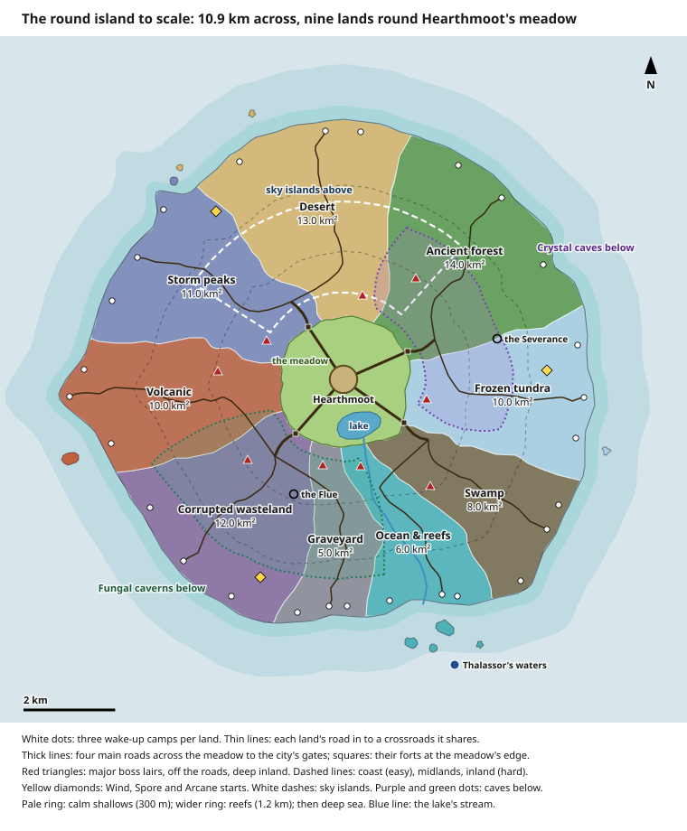

# The round island: layout for sign-off (phase 3, step 1)

Plan phase 3 ("One big world") starts by laying the island out to scale for Raven's OK, before any ground is built.
This is that layout. The numbers come from `Tools/terrain/round_island.mjs`, which writes
`Tools/terrain/round_island_layout.json` (every number the build scripts will use: coast, land outlines, borders,
roads, camps, places) and `round_island_map.svg` beside this file. To change the layout, change the script's inputs and
run it again: `node Tools/terrain/round_island.mjs`.

## What it follows

- **Raven's answers (11-18, the plan doc):** a round island with Hearthmoot in the middle; nine surface lands sized like
  Aaron's lands; 10 to 12 km across, every land scaled up by the same amount (about double the area); open, blended
  borders; easy at the coast, harder inland, guarded roads to the city, bosses off the roads; the sky islands over the
  north, the Crystal caves under the north-east, the Fungal caverns under the south-west; the Ocean all round; Wind,
  Spore and Arcane players wake inside their layer; each land's half of its old pass becomes its road's works (fort,
  champion, mouth shrine); the Old Island stays its own map.
- **Raven 11-19:** the first layout (straight slices meeting at the city) looked too much like a pie. From four sketches
  Raven picked: borders that wander, a rugged coast, roads that join, and Hearthmoot in **a green meadow with a lake on
  the Ocean side**, so no land narrows to a point at the city.
- **Aaron's land sizes** (`Docs/design/cooks/world-map.md` 2.2), times two.

## The lands

Clockwise from the north-west. Bearings are degrees clockwise from north (where each land meets the coast); the bands
are equal depths between the meadow's edge and the coast.

| Land | Path | Aaron's km² | Now km² | Coast | Coast length | Coast / midlands / inland km² | Shares a main road with |
|---|---|---|---|---|---|---|---|
| Storm peaks | Lightning | 5.5 | 11.0 | 279–323° | 4.2 km | 5.1 / 3.3 / 2.5 | Desert |
| Desert | Sun | 6.5 | 13.0 | 323–16° | 5.1 km | 6.0 / 4.4 / 2.6 | Storm peaks |
| Ancient forest | Nature | 7.0 | 14.0 | 16–73° | 5.5 km | 6.8 / 4.7 / 2.5 | Frozen tundra |
| Frozen tundra | Frost | 5.0 | 10.0 | 73–113° | 3.8 km | 4.4 / 3.3 / 2.2 | Ancient forest |
| Swamp | Blood | 4.0 | 8.0 | 113–146° | 3.3 km | 3.8 / 2.5 / 1.8 | Ocean & reefs |
| Ocean & reefs (shore) | Tide | 3.0 | 6.0 | 146–174° | 2.6 km | 3.0 / 1.9 / 1.1 | Swamp |
| Graveyard | Necromancy | 2.5 | 5.0 | 174–196° | 2.0 km | 2.2 / 1.8 / 1.1 | Wasteland, Volcanic |
| Corrupted wasteland | Void | 6.0 | 12.0 | 196–248° | 4.9 km | 5.8 / 4.1 / 2.2 | Graveyard, Volcanic |
| Volcanic | Fire | 5.0 | 10.0 | 248–279° | 3.1 km | 4.2 / 3.7 / 2.1 | Graveyard, Wasteland |

- **Size:** 89 km² of land plus Hearthmoot's meadow (6.6 km²): **10.9 km across**, the coast 5.0 to 6.2 km from the
  centre. The volcano cape is the widest point (12.4 km across).
- **Borders wander:** each border bends along ridges, rivers and valleys instead of running straight to the city; the
  build blends the two lands over about 200 m either side (trees thinning into sand, snow patches into marsh). Every
  land keeps exactly its size.
- **A rugged coast:** the Volcanic juts out as a volcano cape; the Ocean shore curves into a reef bay with islets across
  its mouth; a cliff cape with sea stacks below the Storm peaks; an icy headland on the Tundra; the Swamp's muddy delta;
  the Desert's long dune coast; a forest inlet. Nine islets in all.
- **Why this order:** the sky is thickest over Storm, Desert and Forest, so they take the north; the Crystal caves lie
  under Forest and Tundra, the Fungal caverns under Graveyard and Wasteland; the Ocean keeps its shore in the south, by
  the meadow's lake. Opposites face each other across the city: Sun and Tide, Nature and Necromancy, Fire and Frost,
  Lightning and Blood (and the Wasteland faces the Crystal caves, Void and Arcane).

## Roads, camps and each land's places

- **Three wake-up camps** on each land's coast; the middle one starts the land's road.
- **Each land's own road** runs in down the middle of its land (3.2 to 5.2 km), past its **mouth shrine** where it
  leaves the coast band and its **champion** where it enters the inland band, then turns to a **crossroads** it shares
  with its neighbours, about 700 m out from the meadow.
- **Four main roads** run from the crossroads across the meadow to the city's four gates, each with its **fort** at the
  meadow's edge: Storm peaks + Desert (north-west), Forest + Tundra (east), Swamp + Ocean shore (south-east, passing
  east of the lake), Graveyard + Wasteland + Volcanic (south-west).
- **Each major boss** sits deep inland and off the roads: the spot in its land's inland band farthest from every road,
  its land's borders and the other bosses (370 to 750 m from the nearest road).

## Hearthmoot and its meadow

- Walls **600 m across** on a low hill in the middle of **the meadow**: green, open, guarded ground about 2.9 km
  across with an uneven edge. It is the Commons: no wild creatures, fully safe, nothing owned inside (Raven's answers).
  The four main roads cross it to the gates.
- **The lake** (0.44 km²) sits in the meadow on the Ocean side, south of the walls. Its stream runs 4 km out through the
  Ocean shore into the reef bay.
- **Twelve quarters**, one per path, 30° each, in the ring's order so each land's quarter lies towards its land where
  it can: Lightning, Wind, Sun, Nature, Arcane, Frost, Blood, Tide, Necromancy, Spore, Void, Fire. Wind's, Arcane's and
  Spore's quarters sit between the lands their layers lie over or under. Each quarter opens when its land's boss falls.

## The layers

| Layer | Where | Size | Ways in |
|---|---|---|---|
| Sky islands | Over Storm, Desert and Forest (303–43°), 1.9 to 3.9 km from the centre, 500 to 1,300 m up; a few over other lands | 4 km² of islands in ~10 km² of air | Updrafts, gliding, flying mounts |
| Crystal caves | Under Forest and Tundra (23–108°), 1.75 to 2.9 km from the centre | ~4 km² | The Severance (a rift-cut gorge on the Forest–Tundra border), crystal rifts |
| Fungal caverns | Under Graveyard and Wasteland (172–239°), 1.75 to 3.7 km from the centre | ~6 km² | Cave mouths, sinkholes; the Flue rises from its floor to the surface, a sky island anchored over it |

- **Starts inside the layers (Raven Q18):** Wind on a low starter sky island over the north coast (ropes, ledges and
  updrafts down); Spore in a shallow cavern under the south-west coast; Arcane in a shallow crystal hall under the
  north-east coast. No markings out of the two caverns.
- No sea or rain inside caverns; a dim glow that pulses with the day above.

## The sea

Calm shallows 300 m out from every coast (by the camps), reefs out to 1.2 km, then deep water; Thalassor's waters past
the reef bay south of the Ocean's shore; the level is 16 km square. Open sea counts as Ocean & reefs.

## After the OK

The build goes land by land, each checked against its land's design and its landmark checklist from the same camera
spots, with pictures for Raven at each land. Proposed first: Hearthmoot with its meadow, lake and main roads, then
Volcanic and Frozen tundra (their content and creatures exist on the Old Island, so the method is proven on known
ground), then the rest round the ring.
